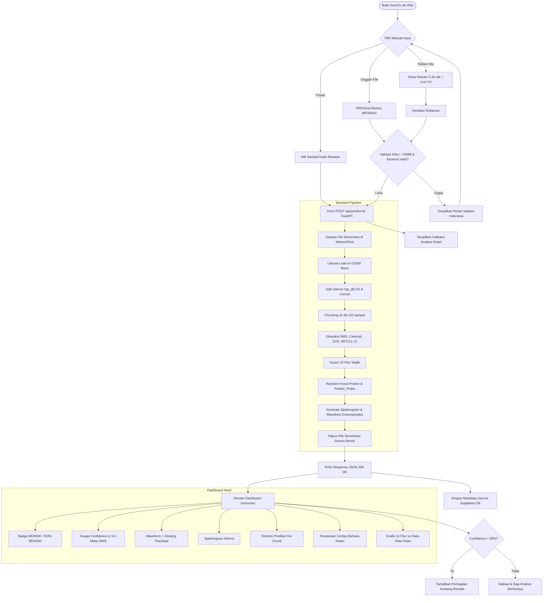

# Product Requirements Document (PRD)
## Sound Lab: Sistem Klasifikasi Akustik Lingkungan (Berisik vs. Non-Berisik)

> **Ringkasan Eksekutif:**  
> Dokumen ini mendefinisikan kebutuhan produk untuk platform web *Sound Lab*, aplikasi web berbasis sains data yang mengklasifikasikan rekaman audio lingkungan menjadi kategori **BERISIK** atau **NON-BERISIK** secara otomatis dan presisi. Menggunakan model *Random Forest* dengan 10 fitur ekstraksi akustik optimal, sistem ini ditujukan untuk kebutuhan akademik, evaluasi pengujian, demonstrasi interaktif, serta pemantauan kenyamanan akustik ruangan secara transparan, akuntabel, dan aman privasi.

---

## Daftar Isi
1. [Latar Belakang & Pernyataan Masalah](#1-latar-belakang--pernyataan-masalah)
2. [Tujuan Produk & Batasan (Non-Goals)](#2-tujuan-produk--batasan-non-goals)
3. [Target Pengguna & User Persona](#3-target-pengguna--user-persona)
4. [User Stories & Prioritas MoSCoW](#4-user-stories--prioritas-moscow)
5. [Daftar Fitur & Acceptance Criteria](#5-daftar-fitur--acceptance-criteria)
6. [Alur Pengguna (User Flow) & Diagram Mermaid](#6-alur-pengguna-user-flow--diagram-mermaid)
7. [Kebutuhan Non-Fungsional (NFR)](#7-kebutuhan-non-fungsional-nfr)
8. [Metrik Keberhasilan Produk](#8-metrik-keberhasilan-produk)
9. [Manajemen Risiko](#9-manajemen-risiko)
10. [Asumsi Eksplisit](#10-asumsi-eksplisit)
11. [Ruang Lingkup di Luar Produk (Out-of-Scope)](#11-ruang-lingkup-di-luar-produk-out-of-scope)

---

## 1. Latar Belakang & Pernyataan Masalah

### 1.1 Latar Belakang
Polusi suara lingkungan kampus dan ruang belajar (seperti laboratorium, perpustakaan, dan ruang kelas) berdampak signifikan terhadap konsentrasi, produktivitas, dan kenyamanan pengguna. Dalam mata kuliah Proyek Sains Data (PSD) Teknik Informatika, telah dikembangkan model Machine Learning berbasis *Random Forest* yang mampu membedakan sinyal audio menjadi **BERISIK** (*noisy/loud*) dan **NON-BERISIK** (*quiet/acceptable*) dengan akurasi pengujian 85%.

Meskipun model telah berhasil divalidasi dalam format notebook Python, pemangku kepentingan (dosen penguji, mahasiswa, dan pengelola fasilitas) memerlukan antarmuka web interaktif yang intuitif untuk menguji, memvisualisasikan, dan memahami inferensi model secara nyata tanpa harus menjalankan skrip kode manual.

### 1.2 Pernyataan Masalah
1. **Ketertutupan Model (Black Box):** Pengguna awam maupun akademisi kesulitan memahami alasan mengapa suatu audio diklasifikasikan sebagai bising tanpa adanya visualisasi representasi sinyal (spektrogram, waveform, dan kontribusi fitur).
2. **Ketiadaan Media Pengujian Interaktif:** Pengujian model selama ini terbatas pada dataset statis lokal. Dibutuhkan kemampuan pengujian langsung melalui unggah berkas dan perekaman mikrofon seketika (*real-time recording*).
3. **Kekhawatiran Privasi Audio:** Pengguna ragu mengunggah rekaman suara ruangan jika berkas suara mereka disimpan secara permanen di peladen (*server*).

---

## 2. Tujuan Produk & Batasan (Non-Goals)

### 2.1 Tujuan Produk (Goals)
- Menyediakan platform berbasis web responsif bergaya instrumen ilmiah (*Sound Lab*) untuk mendemonstrasikan kapabilitas model klasifikasi audio.
- Memberikan waktu respons inferensi cepat (< 10 detik untuk audio 30 detik).
- Menampilkan hasil diagnosis prediktif lengkap dengan probabilitas, visualisasi waveform, spektrogram inferno, timeline prediksi per chunk (3 detik), serta perbandingan 10 fitur akustik terhadap rata-rata kelas pelatihan (*explainable AI*).
- Menyediakan riwayat analisis berbasis sesi dengan penyimpanan metadata di Supabase serta dukungan ekspor laporan CSV.
- Menjamin privasi pengguna dengan prinsip *Zero Raw-Audio Retention* (berkas audio mentah segera dihapus dari peladen setelah ekstraksi fitur selesai).

### 2.2 Batasan Produk (Non-Goals)
- Sistem **bukan** alat pemantauan sensor IoT 24/7 *streaming* berdaya rendah (bukan sistem *edge surveillance*).
- Sistem **tidak** melakukan transkripsi percakapan (*Speech-to-Text*) atau deteksi kata kunci sensitif.
- Sistem **tidak** mengklasifikasikan jenis suara secara multi-kelas granular (misalnya memisahkan suara knalpot, tangisan bayi, atau sirine secara spesifik); klasifikasi murni biner: **BERISIK** vs **NON-BERISIK**.

---

## 3. Target Pengguna & User Persona

### 3.1 Profil Target Pengguna
| Kelompok Pengguna | Karakteristik & Kebutuhan Utama | Tingkat Kemahiran Teknis |
| :--- | :--- | :--- |
| **Dosen / Penguji PSD** | Menilai validitas metodologi, konsistensi ekstraksi fitur, paritas training-vs-inferensi, dan ketahanan model pada data uji. | Sangat Tinggi |
| **Mahasiswa Rekan Sejawat** | Mengeksplorasi performa model, mencoba contoh audio bising/sunyi, dan membandingkan 2 file audio untuk tugas kuliah. | Menengah |
| **Pengelola Fasilitas Kampus** | Menguji rekaman kebisingan ruangan untuk verifikasi kelayakan suasana tenang di perpustakaan/ruang baca. | Dasar / Awam |

### 3.2 User Persona

#### Persona 1: Dr. Irfan (Dosen Penguji Mata Kuliah PSD)
- **Tujuan:** Memvalidasi bahwa arsitektur ekstraksi sinyal (split silence, chunking 3 detik, 10 fitur) benar-benar konsisten dengan data latih, dan melihat metrik evaluasi model (85% akurasi, F1 0.85, ROC-AUC 0.8688).
- **Poin Frustrasi:** Web demo yang hanya menampilkan label akhir tanpa transparansi metrik teknis atau detail pipeline pengolahan sinyal digital.

#### Persona 2: Alifah (Mahasiswa Teknik Informatika)
- **Tujuan:** Mencoba merekam audio ruangan menggunakan mikrofon laptop untuk melihat apakah diskusinya terdeteksi berisik, serta melihat spektrogram dan timeline per chunk.
- **Poin Frustrasi:** Antarmuka yang lambat, gagal upload file .mp3 tanpa pesan error jelas, atau tampilan yang membingungkan.

#### Persona 3: Pak Joko (Kepala Pengelola Perpustakaan)
- **Tujuan:** Memastikan tingkat kebisingan di ruang baca lantai 2 dapat dibuktikan objektif sebelum menegur pengunjung.
- **Poin Frustrasi:** Istilah teknis yang terlalu rumit tanpa ada ringkasan bahasa awam "mengapa audio ini diklasifikasikan berisik".

---

## 4. User Stories & Prioritas MoSCoW

| ID | User Story (Sebagai... Saya ingin... Agar...) | Prioritas MoSCoW | Kriteria Penerimaan Terkait |
| :--- | :--- | :--- | :--- |
| **US-01** | Sebagai mahasiswa, saya ingin mengunggah berkas audio via *drag-and-drop* (.mp3/.wav), agar saya dapat menganalisis sampel rekaman dengan cepat. | **Must Have** | AC-01 |
| **US-02** | Sebagai penguji, saya ingin memilih contoh audio yang sudah disediakan, agar saya dapat langsung menguji sistem tanpa mencari file audio sendiri. | **Must Have** | AC-03 |
| **US-03** | Sebagai pengguna, saya ingin merekam suara langsung melalui mikrofon peramban (5-30 dtk) dengan indikator visual level volume, agar dapat melakukan tes spontan. | **Must Have** | AC-02 |
| **US-04** | Sebagai dosen, saya ingin melihat label prediksi, skor keyakinan (*confidence*), dan probabilitas kedua kelas, agar saya dapat mengukur kepastian klasifikasi. | **Must Have** | AC-05 |
| **US-05** | Sebagai akademisi, saya ingin melihat visualisasi waveform tersinkronisasi pemutar audio dan spektrogram berskala "inferno", agar representasi frekuensi sinyal terlihat jelas. | **Must Have** | AC-04, AC-06 |
| **US-06** | Sebagai pengguna, saya ingin melihat timeline prediksi per chunk 3 detik dengan label indikatif, agar saya tahu detik ke berapa suara keras terjadi. | **Should Have** | AC-07 |
| **US-07** | Sebagai penguji, saya ingin melihat nilai 10 fitur terpilih dibandingkan dengan rata-rata data latih, agar saya mengetahui karakteristik fisik akustik sampel. | **Should Have** | AC-08 |
| **US-08** | Sebagai pengguna awam, saya ingin membaca penjelasan dalam bahasa manusia biasa yang menerangkan alasan hasil prediksi, agar saya paham tanpa latar belakang PSD. | **Should Have** | AC-09 |
| **US-09** | Sebagai pengguna, saya ingin mendapatkan peringatan visual ketika nilai *confidence* rendah (< 65%), agar saya waspada terhadap audio yang ambigu. | **Should Have** | AC-10 |
| **US-10** | Sebagai mahasiswa, saya ingin riwayat analisis tersimpan selama sesi berlangsung dan dapat diunduh dalam berkas CSV, agar dapat dilampirkan pada laporan tugas. | **Should Have** | AC-11 |
| **US-11** | Sebagai peneliti, saya ingin membandingkan dua file audio secara berdampingan (*side-by-side*), agar perbedaan fitur keduanya terlihat kontras. | **Could Have** | AC-12 |
| **US-12** | Sebagai audiens, saya ingin membaca halaman "Tentang Model" dan "Batasan & Etika", agar memahami metrik sains data dan batas operasional sistem. | **Must Have** | AC-13, AC-14 |

---

## 5. Daftar Fitur & Acceptance Criteria (AC)

### Fitur 1: Area Unggah Berkas Drag-and-Drop
- **Deskripsi:** Komponen zona unggah file audio interaktif.
- **Acceptance Criteria (AC-01):**
  - Menerima format: `.mp3`, `.wav`, `.ogg`, `.flac`, `.m4a`. Format lain ditolak dengan pesan error Indonesia.
  - Membatasi ukuran berkas maksimal 15 MB. Jika > 15 MB, muncul pesan penolakan instan di sisi klien sebelum diunggah.
  - Membatasi durasi audio maksimal 120 detik (divalidasi di backend).
  - Terdapat efek visual drag-over yang menyala saat berkas diseret ke atas area.

### Fitur 2: Perekaman Suara Mikrofon Langsung
- **Deskripsi:** Modul perekaman audio peramban via `MediaRecorder` API.
- **Acceptance Criteria (AC-02):**
  - Mengizinkan perekaman dengan rentang durasi 5 detik hingga maksimal 30 detik.
  - Menampilkan VU-meter dinamis *live* yang bergerak merespons volume suara masukan saat merekam.
  - Menampilkan timer hitung mundur (*countdown*) visual.
  - Tombol rekam memiliki animasi denyut (*pulse*) merah saat aktif.
  - Jika perekaman < 5 detik, muncul peringatan "Durasi rekaman minimal 5 detik".

### Fitur 3: Sampel Audio Bawaan (*Presets*)
- **Deskripsi:** Tombol akses cepat ke 4 file sampel uji bawaan peladen.
- **Acceptance Criteria (AC-03):**
  - Menyediakan sampel: "24-003 berisik (1).mp3", "24-003 berisik (2).mp3", "24-003 sunyi 2.mp3", dan "Audio Ambigu/Campuran.wav".
  - Sekali klik langsung memicu proses analisis tanpa perlu unduh-unggah manual.

### Fitur 4: Pemutar Audio Terintegrasi Waveform
- **Deskripsi:** Audio player dengan visualisasi waveform dan kursor pemutaran.
- **Acceptance Criteria (AC-04):**
  - Waveform ter-downsample (minimal 200 titik) tampil proporsional.
  - Garis kursor vertikal bercahaya menyapu waveform secara mulus (*smooth playback sweep*) sinkron dengan waktu pemutaran audio.
  - Pengguna dapat mengklik sembarang titik pada waveform untuk melompat (*seek*) ke detik tersebut.

### Fitur 5: Kartu Hasil Berbentuk Instrumen Sains
- **Deskripsi:** Panel utama penyajian hasil klasifikasi.
- **Acceptance Criteria (AC-05):**
  - Menampilkan badge status: Pill oranye-amber dengan ikon speaker untuk **BERISIK**, atau pill cyan-teal dengan ikon speaker-mute untuk **NON-BERISIK**.
  - Menggunakan *semi-circular gauge* untuk visualisasi persentase *confidence* (0-100%).
  - Angka *confidence* menggunakan animasi angka menghitung naik (*counter*) selama 800 ms.
  - Menampilkan probabilitas kedua kelas secara eksplisit (diambil dinamis dari `model.classes_`).

### Fitur 6: Visualisasi Spektrogram "Inferno"
- **Deskripsi:** Gambar spektrogram frekuensi audio yang dihasilkan dari backend.
- **Acceptance Criteria (AC-06):**
  - Menggunakan colormap `inferno` persis seperti notebook pelatihan.
  - Sumbu horizontal menampilkan waktu (detik), sumbu vertikal menampilkan frekuensi (Hz/kHz).
  - Terdapat opsi *zoom modal* untuk melihat spektrogram dalam resolusi penuh.

### Fitur 7: Timeline Prediksi Per Chunk (3 Detik)
- **Deskripsi:** Bar horizontal visualisasi segmen audio per potongan 3 detik.
- **Acceptance Criteria (AC-07):**
  - Tiap blok 3 detik diberi warna sesuai prediksi blok tersebut (oranye untuk chunk bising, cyan untuk chunk sunyi).
  - Label disematkan secara tegas di atas komponen: *"Prediksi Per-Chunk (Indikatif - Model dilatih pada agregat 30 detik)"*.
  - Mengarahkan kursor (*hover*) pada blok menampilkan detik mulai-selesai dan probabilitas chunk tersebut.

### Fitur 8: Perbandingan 10 Fitur vs Rata-Rata Kelas Latih
- **Deskripsi:** Grafik batang interaktif membandingkan nilai 10 fitur audio yang diuji terhadap data referensi `class_means.json`.
- **Acceptance Criteria (AC-08):**
  - 10 fitur disusun sesuai urutan wajib: `rms_mean`, `mfcc1_mean`, `rms_std`, `mfcc3_mean`, `zcr_mean`, `mfcc6_mean`, `mfcc7_mean`, `mfcc13_mean`, `mfcc5_mean`, `centroid_mean`.
  - Tiap fitur memiliki indikator: apakah nilainya lebih mendekati profil rata-rata "Berisik" atau "Non-Berisik".

### Fitur 9: Penjelasan Cerdas Bahasa Awam (*Explainability*)
- **Deskripsi:** Narasi otomatis yang menjembatani data matematis ke pemahaman manusia.
- **Acceptance Criteria (AC-09):**
  - Memberikan 2-3 kalimat penjelasan kontekstual berdasarkan fitur dominan.
  - Contoh: *"Audio ini memiliki intensitas energi (RMS) tinggi (0.077) dan frekuensi dominan tajam (Centroid 2132 Hz), yang merupakan karakteristik utama kebisingan lingkungan seperti percakapan ramai atau gesekan benda keras."*

### Fitur 10: Peringatan Ambang Batas Rendah (*Low-Confidence Alert*)
- **Deskripsi:** Banner peringatan bila hasil klasifikasi berada pada area abu-abu.
- **Acceptance Criteria (AC-10):**
  - Jika $\max(P(\text{berisik}), P(\text{non-berisik})) < 0.65$ (65%), tampilkan kartu peringatan bergaris tepi kuning/amber redup.
  - Pesan peringatan: *"Tingkat keyakinan model rendah (< 65%). Sinyal audio memiliki karakteristik campuran atau berada di luar distribusi suara pelatihan. Disarankan menguji ulang dengan rekaman yang lebih jelas."*

### Fitur 11: Riwayat Sesi & Ekspor CSV
- **Deskripsi:** Tabel penyimpanan riwayat pengujian selama pengguna membuka aplikasi.
- **Acceptance Criteria (AC-11):**
  - Menyimpan metadata di Supabase (tabel `analysis_history`): nama file, durasi, label hasil, confidence, 10 nilai fitur, dan timestamp.
  - Tabel riwayat dapat disaring berdasarkan label (Semua, Berisik, Non-Berisik).
  - Tombol "Ekspor CSV" mengunduh file `.csv` terformat rapi berisi seluruh kolom fitur dan hasil pengujian sesi terkait.

### Fitur 12: Komparasi Dua Audio (*Side-by-Side Comparison*)
- **Deskripsi:** Tab komparator untuk menguji dua file sekaligus.
- **Acceptance Criteria (AC-12):**
  - Menampilkan dua panel input berdampingan (Audio A vs Audio B).
  - Menampilkan perbandingan langsung: perbedaan kelas, selisih RMS, selisih Centroid, dan overlay profil 13 MFCC.

### Fitur 13 & 14: Halaman Tentang Model & Batasan & Etika
- **Deskripsi:** Halaman dokumentasi ilmiah dan tanggung jawab AI.
- **Acceptance Criteria (AC-13 & AC-14):**
  - Halaman "Tentang Model" memuat: arsitektur Random Forest (100 pohon, max_depth=10), 10 fitur terpilih dari 19 fitur awal, metrik uji 85%, confusion matrix (17/3 per kelas), dan perbandingan 6 model.
  - Halaman "Batasan & Etika" memuat: pernyataan privasi (file audio mentah otomatis dihapus setelah inferensi), keterbatasan model (dilatih pada ~200 sampel satu domain, rentan salah pada suara hujan/musik/mesin berat).

---

## 6. Alur Pengguna (User Flow) & Diagram Mermaid

### 6.1 Langkah Alur Pengguna (User Journey)
1. Pengguna membuka halaman utama (Analisis).
2. Pengguna memilih metode input: (A) Seret file audio, (B) Klik rekam suara mikrofon, atau (C) Pilih salah satu audio contoh.
3. Frontend Next.js memvalidasi ukuran dan format file di sisi peramban.
4. Berkas dikirimkan ke endpoint FastAPI `/api/predict`.
5. Backend memproses audio melalui pipeline ekstraksi (split-silence, chunking 3 detik, ekstraksi 10 fitur).
6. Model *Random Forest* melakukan inferensi (`predict` & `predict_proba`).
7. Backend menghasilkan visualisasi (waveform, spektrogram inferno, per-chunk data) dan mengembalikan respons JSON.
8. Frontend Next.js menyimpan ringkasan ke tabel database Supabase dan merender seluruh panel instrumen hasil secara reaktif.
9. Pengguna dapat mengeksplorasi penjelasan fitur, memutar audio, melihat timeline per-chunk, atau mengunduh riwayat pengujian.

### 6.2 Diagram Alur Pengguna (Mermaid)

---

## 7. Kebutuhan Non-Fungsional (NFR)

| Kategori | Parameter | Target Terukur |
| :--- | :--- | :--- |
| **Performa & Latensi** | Waktu inferensi end-to-end | $\le 10$ detik untuk berkas audio berdurasi 30 detik pada kondisi jaringan stabil. |
| **Batas Ukuran Berkas** | Payload upload maksimal | Maksimal 15 MB per pengiriman. Berkas di atasnya ditolak di HTTP status 413. |
| **Batas Durasi Audio** | Durasi rekaman / file | Maksimal 120 detik. Audio lebih panjang akan ditolak atau dipotong secara aman dengan notifikasi. |
| **Keamanan & Privasi** | Retensi data audio mentah | **Zero Storage Policy**: Berkas audio mentah segera dihapus dari filesystem server pada blok `finally` setelah ekstraksi fitur selesai. Tidak ada rekaman suara pengguna yang disimpan permanen. |
| **Privasi Database** | Data di Supabase | Hanya menyimpan metadata anonim: `session_id`, `filename`, `duration`, `prediction_label`, `confidence`, `features_json`, `created_at`. |
| **Responsivitas UI** | Breakpoint perangkat | Responsif penuh pada resolusi Mobile (360px), Tablet (768px), dan Desktop (1280px+). |
| **Aksesibilitas** | Kepatuhan standar web | Standar WCAG 2.1 Level AA (rasio kontras teks $\ge 4.5:1$, navigasi tab keyboard, tag ARIA). |
| **Ketersediaan (SLA)** | Uptime layanan | Berjalan pada platform PaaS/Free-tier dengan ketersediaan target 99% selama sesi demo penilaian. |

---

## 8. Metrik Keberhasilan Produk

1. **Keberhasilan Tugas (Task Success Rate):** $\ge 98\%$ sesi pengujian (unggah, rekam, atau preset) berhasil menghasilkan kartu diagnosis tanpa crash/error 500.
2. **Latensi Rata-Rata:** Median pemrosesan inferensi $\le 6.5$ detik pada audio berdurasi 30 detik.
3. **Paritas Fitur Model:** Nilai 10 fitur yang diekstraksi di backend web app memiliki korelasi $\ge 0.99$ terhadap hasil data latih notebook.
4. **Tingkat Kepuasan Pengguna (CSAT):** Skor rata-rata $\ge 4.5/5.0$ pada kuisioner demonstrasi dosen penguji dan rekan mahasiswa mengenai kejelasan visualisasi dan penjelasan bahasa awam.

---

## 9. Manajemen Risiko

| Risiko | Tingkat Dampak | Probabilitas | Rencana Mitigasi |
| :--- | :---: | :---: | :--- |
| **Cold Start Peladen Backend (Free Tier)** | Sedang | Tinggi | Menambahkan indikator status pemanasan server (*warming up*) di Next.js saat pertama kali memanggil `/api/health`. |
| **Audio Mengandung Kebisingan Unik (OOD)** | Sedang | Menengah | Menerapkan ambang peringatan *confidence* $< 65\%$ agar pengguna waspada terhadap hasil yang ambigu. |
| **Batas RAM Peladen Terlampaui (OOM Librosa)** | Tinggi | Rendah | Mengunci batas durasi maksimal 120 detik dan melakukan *downsampling* sinyal secara bertahap saat pembacaan file. |
| **Ketidakcocokan Versi Scikit-Learn** | Sangat Tinggi | Rendah | Mengunci (*pin*) secara ketat `scikit-learn==1.8.0` di `requirements.txt`. |

---

## 10. Asumsi Eksplisit

1. Pengguna mengakses aplikasi menggunakan peramban modern yang mendukung Web Audio API dan MediaStream Recording (Google Chrome, Mozilla Firefox, Microsoft Edge, atau Safari versi terbaru).
2. Peramban pengguna memberikan izin akses mikrofon jika menggunakan fitur perekaman langsung.
3. Backend dijalankan pada lingkungan yang telah memiliki dependensi sistem `ffmpeg` untuk memproses berkas audio berformat `.mp3` dan `.m4a`.
4. Database Supabase dikonfigurasi dengan skema tabel publik `analysis_history` yang dapat ditulis menggunakan kunci anonim (*Anon Public Key*) dengan proteksi RLS berbasis sesi ID.

---

## 11. Ruang Lingkup di Luar Produk (Out-of-Scope)

- Autentikasi multi-user kompleks dengan pendaftaran akun email/password (aplikasi beroperasi dengan identifikasi berbasis sesi lokal).
- Pelatihan ulang model (*retraining*) atau penyesuaian bobot pohon (*fine-tuning*) langsung dari antarmuka web.
- Fitur penghapusan kebisingan (*noise cancellation/cleaning audio filter*) untuk mengunduh audio hasil pembersihan.
- Integrasi perangkat keras sensor mikrokontroler (Arduino/ESP32) secara fisik ke peladen.
