# Arsitektur Sistem & Spesifikasi Teknis (System Architecture)
## Sound Lab: Decoupled Full-Stack Architecture (FastAPI + Next.js + Supabase)

> **Ringkasan Eksekutif:**  
> Dokumen ini menguraikan arsitektur sistem menyeluruh untuk platform *Sound Lab*, mencakup pembagian kerja terpisah (*decoupled architecture*) antara frontend modern Next.js, backend komputasi sinyal Python FastAPI, dan basis data cloud Supabase. Dokumen ini menjelaskan alur data *end-to-end*, manajemen beban CPU librosa dengan *threadpool*, proteksi privasi file temporer, strategi pemuatan model *in-memory singleton*, serta rencana deployment realistis dan terjangkau untuk lingkungan akademis.

---

## Daftar Isi
1. [Diagram Arsitektur Sistem (Mermaid)](#1-diagram-arsitektur-sistem-mermaid)
2. [Pemilihan Teknologi (Tech Stack) & Rasionalitas](#2-pemilihan-teknologi-tech-stack--rasionalitas)
3. [Struktur Folder & Berkas Proyek](#3-struktur-folder--berkas-proyek)
4. [Alur Data End-to-End (Data Flow)](#4-alur-data-end-to-end-data-flow)
5. [Strategi Pemuatan Model & Cache Startup](#5-strategi-pemuatan-model--cache-startup)
6. [Asynchronous Processing & Threadpool Execution](#6-asynchronous-processing--threadpool-execution)
7. [Siklus Hidup File Temporer & Privasi Data](#7-siklus-hidup-file-temporer--privasi-data)
8. [CORS, Rate Limiting, & Keamanan API](#8-cors-rate-limiting--keamanan-api)
9. [Strategi Observabilitas & Structured Logging](#9-strategi-observabilitas--structured-logging)
10. [Konfigurasi Lingkungan (.env)](#10-konfigurasi-lingkungan-env)
11. [Rencana Deployment & Analisis Biaya Mahasiswa](#11-rencana-deployment--analisis-biaya-mahasiswa)
12. [Trade-Off & Keputusan Desain Arsitektural](#12-trade-off--keputusan-desain-arsitektural)

---

## 1. Diagram Arsitektur Sistem (Mermaid)

```mermaid
flowchart TB
    subgraph ClientLayer["Klien / Peramban Pengguna"]
        BrowserUI["Next.js Web UI\n(App Router + Canvas/Audio API)"]
        UserMic["MediaRecorder API\n(Perekaman Suara 5-30s)"]
        UserUpload["HTML5 File Dropzone\n(.mp3 / .wav / .m4a <= 15MB)"]
        BrowserUI --> UserMic
        BrowserUI --> UserUpload
    end

    subgraph EdgeFrontend["Frontend Platform (Vercel Edge/Serverless)"]
        NextServer["Next.js Server Actions\n& API Routes (Proxy / State)"]
        ClientCache["Client-Side Session Cache\n(Zustand / React Context)"]
        BrowserUI <--> NextServer
        BrowserUI <--> ClientCache
    end

    subgraph CloudDB["Supabase Managed Cloud"]
        SupabaseAuth["Supabase Anonymous Session"]
        SupabasePostgres[("PostgreSQL Database\n- analysis_history\n- model_metadata")]
        NextServer <-->|Supabase JS SDK| SupabasePostgres
        BrowserUI -.->|Direct Read History| SupabasePostgres
    end

    subgraph BackendAPI["Machine Learning & DSP Engine (FastAPI)"]
        CORSFilter["FastAPI CORSMiddleware & RateLimiter"]
        LifespanCache["Lifespan Startup Manager\n(Singleton Model In-Memory)"]
        AsyncRoute["POST /api/predict (Async Endpoint)"]
        ThreadPool["ThreadPoolExecutor (CPU Bound DSP)"]
        
        CORSFilter --> AsyncRoute
        LifespanCache --> AsyncRoute
        AsyncRoute --> ThreadPool
        
        subgraph PipelineDSP["Librosa & Scikit-Learn Pipeline"]
            AudioRead["Audio Ingestion (ffmpeg / soundfile)"]
            SplitConcat["Silence Split (top_db=25) & Concat"]
            Chunker["3s Chunk Segmentation (66.150 sample)"]
            FeatureExtract["Feature Extractor (RMS, MFCC, ZCR, Centroid)"]
            ScikitRF["RandomForestClassifier (scikit-learn 1.8.0)"]
            VizGen["Downsample Waveform & Spectrogram Generator"]
            
            AudioRead --> SplitConcat --> Chunker --> FeatureExtract --> ScikitRF
            Chunker --> VizGen
        end
        
        ThreadPool --> PipelineDSP
    end

    subgraph StorageLifecycle["Siklus File Temporer"]
        TempOS[("OS /tmp Storage\n(UUID Named Temp File)")]
        AutoPurge["Finally Block Cleanup\nos.unlink()"]
        AsyncRoute --> TempOS
        PipelineDSP --> TempOS
        PipelineDSP --> AutoPurge
    end

    NextServer -->|Multipart Form-Data| CORSFilter
    PipelineDSP -->|Inference JSON + Viz Data| AsyncRoute
    AsyncRoute -->|JSON 200 OK| NextServer
```



---

## 2. Pemilihan Teknologi (Tech Stack) & Rasionalitas

| Komponen | Pilihan Teknologi | Versi Kunci | Alasan Pemilihan & Rasionalitas |
| :--- | :--- | :--- | :--- |
| **Frontend Framework** | **Next.js (App Router)** | `14.x` / `15.x` | Arsitektur modern, performa tinggi dengan *Server Components*, routing bawaan, dan kemudahan deployment di Vercel. |
| **Styling & UI Kit** | **Tailwind CSS + Lucide Icons** | Tailwind `3.4+` | Kebebasan kustomisasi token warna sesuai tema *Sound Lab*, ukuran bundle kecil, performa render cepat. |
| **Backend ML Engine** | **FastAPI** | `0.111+` | Framework Python tercepat berbasis ASGI, integrasi OpenAPI otomatis, dukungan `async/await` murni, dan penanganan *threadpool* efisien. |
| **Server ASGI** | **Uvicorn (Standard)** | `0.30+` | Server web performa tinggi untuk eksekusi aplikasi FastAPI. |
| **Model ML Core** | **Scikit-Learn** | **`1.8.0` (WAJIB)** | **Wajib dipin ketat** agar file `model_klasifikasi_audio.pkl` dapat dimuat tanpa distorsi serialisasi `joblib` atau warning versi. |
| **Audio Processing** | **Librosa & SoundFile** | Librosa `0.10.2` | Standar emas riset sains data audio. Mendukung `effects.split`, ekstraksi MFCC, spektral centroid, dan RMS secara presisi numerik. |
| **Sistem Audio Decoder**| **FFmpeg** | `6.x / 7.x` | Dependensi sistem Linux/Windows untuk membaca format terkompresi `.mp3`, `.m4a`, dan `.ogg`. |
| **Database & Riwayat**| **Supabase (PostgreSQL)** | Cloud / PostgREST | Penyimpanan tabel riwayat analisis sesi, performa tinggi, gratis untuk penggunaan mahasiswa, dan terhubung mulus dengan Next.js. |

---

## 3. Struktur Folder & Berkas Proyek

Proyek disusun dengan pemisahan direktori yang jelas antara antarmuka, inferensi, artefak data, sampel, dan dokumentasi:

```text
WebPSD/
├── backend/                        # Layanan Python FastAPI ML & DSP
│   ├── app/
│   │   ├── __init__.py
│   │   ├── main.py                 # Inisialisasi FastAPI, CORS, middleware, lifespan
│   │   ├── config.py               # Pydantic BaseSettings untuk variabel lingkungan
│   │   ├── dependencies.py         # Injeksi model singleton & utilitas
│   │   ├── api/
│   │   │   ├── __init__.py
│   │   │   └── routes.py           # Endpoint: /predict, /model-info, /health
│   │   ├── core/
│   │   │   ├── __init__.py
│   │   │   ├── audio_pipeline.py   # Logika librosa: split, concat, chunking, 10 fitur
│   │   │   ├── model_loader.py     # joblib loading model_klasifikasi_audio.pkl
│   │   │   ├── explainability.py   # Komparasi fitur vs class_means & narasi awam
│   │   │   └── visualizer.py       # Waveform downsampling & spectrogram rendering
│   │   └── schemas/
│   │       ├── __init__.py
│   │       └── audio_schema.py     # Pydantic schema request & response
│   ├── tests/                      # Unit test backend
│   │   ├── test_pipeline_parity.py # Uji numerik fitur vs nilai notebook
│   │   ├── test_api_routes.py      # Uji endpoint HTTP & validasi
│   │   └── test_edge_cases.py      # Uji audio hening, korup, stereo
│   ├── Dockerfile                  # Konfigurasi container Linux + ffmpeg
│   ├── requirements.txt            # Dependensi Python ter-pin ketat
│   └── .env.example
│
├── frontend/                       # Aplikasi Web Next.js (App Router)
│   ├── src/
│   │   ├── app/
│   │   │   ├── layout.tsx          # Layout global: sidebar + provider tema
│   │   │   ├── page.tsx            # Halaman Analisis (Utama)
│   │   │   ├── riwayat/
│   │   │   │   └── page.tsx        # Halaman Riwayat Analisis Sesi
│   │   │   ├── bandingkan/
│   │   │   │   └── page.tsx        # Halaman Komparasi Side-by-Side
│   │   │   ├── tentang-model/
│   │   │   │   └── page.tsx        # Halaman Dokumentasi Ilmiah & Metrik Model
│   │   │   └── batasan-etika/
│   │   │       └── page.tsx        # Halaman Batasan Distribusi & Privasi
│   │   ├── components/
│   │   │   ├── ui/                 # Tombol, Badge Pill, Modal, Card
│   │   │   ├── analysis/           # Dropzone, AudioRecorder, ResultCard, GaugeMeter
│   │   │   ├── audio/              # WaveformPlayer (Canvas), SpectrogramModal
│   │   │   ├── charts/             # FeatureComparisonBar, ChunkTimeline
│   │   │   └── layout/             # Sidebar, Header, StatusBadge
│   │   ├── lib/
│   │   │   ├── api-client.ts       # Axios / Fetch wrapper ke backend FastAPI
│   │   │   ├── supabase.ts         # Inisialisasi Supabase client
│   │   │   ├── audio-recorder.ts   # Web Audio API helper (MediaRecorder + VU meter)
│   │   │   └── types.ts            # TypeScript interfaces respons API
│   │   └── styles/
│   │       └── globals.css         # Token CSS tema Sound Lab
│   ├── package.json
│   ├── tailwind.config.ts          # Integrasi token palet warna Sound Lab
│   ├── tsconfig.json
│   └── .env.local.example
│
├── data/                           # Model & Bobot Referensi
│   ├── model_klasifikasi_audio.pkl # Model Random Forest serialisasi joblib
│   ├── class_means.json            # Nilai rata-rata 10 fitur per kelas dari train data
│   └── train_summary_metrics.json  # Rekap evaluasi: 85% akurasi, CV, matrix konfusi
│
├── samples/                        # Audio Sampel Bawaan Pengujian
│   ├── 24-003 berisik (1).mp3      # Sampel uji paritas bising 1
│   ├── 24-003 berisik (2).mp3      # Sampel uji paritas bising 2
│   ├── 24-003 sunyi 2.mp3          # Sampel uji paritas sunyi
│   └── audio_ambigu_campuran.wav   # Sampel uji edge-case ambiguitas
│
├── docs/                           # Dokumentasi Spesifikasi Teknis
│   ├── PRD.md
│   ├── desain.md
│   ├── arsitektur.md
│   ├── model-spec.md
│   ├── api-spec.md
│   ├── testing.md
│   ├── tasks.md
│   └── prompt.md
│
├── README.md
└── docker-compose.yml              # Orkestrasi lokal pengembang
```

---

## 4. Alur Data End-to-End (Data Flow)

1. **Inisiasi Klien:** Pengguna memasukkan berkas audio (via dropzone, rekaman Web Audio API, atau tombol preset).
2. **Validasi Sisi Klien:** Next.js memvalidasi MIME type (`audio/mpeg`, `audio/wav`, `audio/x-m4a`, `audio/ogg`, `audio/flac`) dan memastikan ukuran berkas $\le 15$ MB.
3. **HTTP Dispatch:** Next.js mengirimkan `multipart/form-data` dengan field `file` ke FastAPI endpoint `POST /api/predict`.
4. **Penerimaan & Temporary File Storage:** FastAPI menerima stream berkas dan menulisnya ke file temporer sistem (`/tmp/<uuid>.ext`) dengan ekstensi asli untuk diproses oleh `ffmpeg/audioread`.
5. **Threadpool Execution (DSP):** Endpoint memanggil fungsi sinkron `process_audio_pipeline` melalui `asyncio.to_thread` agar eksekusi librosa yang memakan waktu (2-4 detik) tidak membekukan *event loop* asyncio FastAPI.
6. **Ekstraksi Fitur Librosa:**
   - Baca audio pada sampling rate `22050` Hz, konversi ke mono.
   - Deteksi segmen bersuara via `librosa.effects.split(top_db=25)` dan sambungkan kembali dengan `np.concatenate`.
   - Lakukan segmentasi chunk 3 detik (66.150 sampel).
   - Ekstrak RMS, spectral centroid, ZCR, dan MFCC 1-13 per chunk.
   - Agregasi mean dan std pada sumbu waktu, lalu susun tepat 10 fitur wajib.
7. **Inferensi Model:** DataFrame 10 fitur dioper ke `model.predict(X)` dan `model.predict_proba(X)`.
8. **Generasi Visualisasi:** Pembuatan data representasi waveform 200 titik (downsampled min-max) dan spektrogram frekuensi.
9. **Penghapusan File Temporer:** Di dalam blok `finally`, berkas temporer di filesystem peladen langsung dihapus menggunakan `os.unlink()`.
10. **Pengiriman Respons JSON:** FastAPI mengirimkan respons status 200 dengan payload JSON lengkap ke Next.js.
11. **Penyimpanan Riwayat Sesi (Supabase):** Next.js menyimpan catatan ringkasan analisis ke tabel `analysis_history` di Supabase.
12. **Pembaruan Tampilan Reaktif:** Antarmuka Next.js merender kartu instrumen, animasi gauge, grafik perbandingan fitur, waveform terintegrasi, dan timeline chunk secara seketika.

---

## 5. Strategi Pemuatan Model & Cache Startup

Pemuatan model dari file biner `.pkl` berukuran beberapa megabyte menggunakan `joblib` memerlukan waktu 500-1500 ms dan alokasi memori heap. Model **TIDAK BOLEH** dimuat ulang pada setiap *request*.

### Pola In-Memory Singleton (FastAPI Lifespan)
Pada `main.py`, model dimuat sekali saat aplikasi pertama kali boot menggunakan pengelola konteks `lifespan`:

```python
# Konsep Lifespan Singleton di FastAPI
from contextlib import asynccontextmanager
from fastapi import FastAPI
import joblib

model_bundle = {}

@asynccontextmanager
async def lifespan(app: FastAPI):
    # Dijalankan sekali saat server pertama kali start
    bundle = joblib.load("data/model_klasifikasi_audio.pkl")
    # Validasi integritas dict artefak
    assert "model" in bundle and "selected_features" in bundle
    app.state.model = bundle["model"]
    app.state.selected_features = bundle["selected_features"]
    app.state.target_sr = bundle.get("target_sr", 22050)
    app.state.top_db = bundle.get("top_db", 25)
    app.state.chunk_duration = bundle.get("chunk_duration", 3)
    yield
    # Dijalankan saat server shutdown
    app.state.model = None
```

Keuntungan:
- Latensi per request berkurang drastis (hanya waktu komputasi librosa dan inferensi RF).
- Penggunaan memori stabil tanpa kebocoran (*memory leak*).

---

## 6. Asynchronous Processing & Threadpool Execution

Library komputasi numerik seperti `librosa`, `numpy`, dan `scipy` menggunakan instruksi C/Fortran yang bersifat *blocking* (CPU-bound) dan tidak mengenal asynchronous I/O bawaan Python.

### Pencegahan Event-Loop Blocking
Jika fungsi `librosa.load` dipanggil langsung di dalam fungsi `async def`, seluruh koneksi lain yang masuk ke server FastAPI akan tertahan (*starvation*). Solusi arsitektural:

```python
# Pola Pendelegasian ke Worker Thread
import asyncio

@router.post("/api/predict")
async def predict_audio(file: UploadFile, request: Request):
    # 1. Simpan file sementara
    temp_path = await save_upload_to_temp(file)
    try:
        # 2. Delegasikan komputasi berat ke ThreadPool terpisah
        result = await asyncio.to_thread(
            run_audio_dsp_pipeline,
            temp_path,
            request.app.state.model,
            request.app.state.selected_features
        )
        return result
    finally:
        # 3. Jaminan pembersihan file temporer
        cleanup_temp_file(temp_path)
```

Dengan `asyncio.to_thread`, FastAPI menggunakan `ThreadPoolExecutor` default sehingga permintaan lain (seperti pemeriksaan `/health` atau akses frontend) tetap dilayani tanpa terhambat.

---

## 7. Siklus Hidup File Temporer & Privasi Data

Kebijakan privasi aplikasi menegaskan prinsip **Zero Raw Audio Retention**.

### Prosedur Penanganan Berkas
1. Berkas dari peramban ditulis ke direktori temporer sistem dengan nama acak berbasis UUID: `/tmp/{uuid4().hex}_{secure_filename}`.
2. Seluruh alur kerja ekstraksi dibungkus dalam blok proteksi `try ... finally`.
3. Pada blok `finally`:
   ```python
   if os.path.exists(temp_path):
       os.unlink(temp_path)
   ```
4. Bahkan jika terjadi galat (*error/exception*) seperti berkas korup atau pemangkasan memori, file temporer dipastikan langsung dihapus dari disk server.
5. Server tidak memiliki direktori arsip audio publik maupun privat. Yang disimpan hanyalah matriks angka 10 fitur di Supabase.

---

## 8. CORS, Rate Limiting, & Keamanan API

### 8.1 Konfigurasi CORS
FastAPI dikonfigurasi secara ketat untuk hanya menerima lalu lintas dari origin frontend Next.js:
- Domain Produksi: `https://soundlab-psd.vercel.app` (contoh domain produksi).
- Domain Lokal: `http://localhost:3000`, `http://127.0.0.1:3000`.
- Metode yang diizinkan: `GET`, `POST`, `OPTIONS`.

### 8.2 Proteksi Tingkat Permintaan (Rate Limiting)
Karena ekstraksi fitur audio 30 detik membutuhkan $\sim 2-4$ detik waktu CPU, sistem diamankan menggunakan *Rate Limiter* (misalnya menggunakan pustaka `slowapi`):
- Batasan: **10 request per menit per alamat IP**.
- Jika limit terlampaui, kembalikan HTTP `429 Too Many Requests` dengan header `Retry-After: 60`.

---

## 9. Strategi Observabilitas & Structured Logging

Sistem menggunakan format log terstruktur (JSON) untuk kemudahan penelusuran masalah tanpa menyimpan data suara pribadi:

```json
{
  "timestamp": "2026-10-20T14:45:00.120Z",
  "request_id": "c8f2b740-4ef1-4b11-a8cf-892bb59021e1",
  "client_ip": "103.xxx.xxx.xxx",
  "endpoint": "/api/predict",
  "file_name": "24-003 berisik (1).mp3",
  "duration_sec": 27.2,
  "chunk_count": 9,
  "dsp_processing_ms": 2840,
  "inference_ms": 12,
  "prediction": "berisik",
  "confidence": 0.8902,
  "status_code": 200
}
```

---

## 10. Konfigurasi Lingkungan (.env)

### 10.1 Backend (.env)
```ini
# Server
PORT=8000
ENVIRONMENT=production
ALLOWED_ORIGINS=http://localhost:3000,https://soundlab-psd.vercel.app

# Model Artefak
MODEL_BUNDLE_PATH=../data/model_klasifikasi_audio.pkl
CLASS_MEANS_PATH=../data/class_means.json

# Audio Constraints
MAX_UPLOAD_SIZE_MB=15
MAX_AUDIO_DURATION_SEC=120
RATE_LIMIT_PER_MINUTE=10
```

### 10.2 Frontend (.env.local)
```ini
# Backend API
NEXT_PUBLIC_API_URL=http://localhost:8000
# NEXT_PUBLIC_API_URL=https://soundlab-api.onrender.com (saat produksi)

# Supabase
NEXT_PUBLIC_SUPABASE_URL=https://xyzprojectid.supabase.co
NEXT_PUBLIC_SUPABASE_ANON_KEY=eyJhbGciOiJIUzI1NiIsInR5cCI6IkpXVCJ9...
```

### 10.3 Skema Tabel Database Supabase (`analysis_history`)
```sql
CREATE TABLE IF NOT EXISTS public.analysis_history (
    id UUID PRIMARY KEY DEFAULT gen_random_uuid(),
    session_id TEXT NOT NULL,
    filename TEXT NOT NULL,
    duration_sec NUMERIC(6, 2) NOT NULL,
    prediction_label TEXT NOT NULL CHECK (prediction_label IN ('berisik', 'non-berisik')),
    confidence_score NUMERIC(5, 4) NOT NULL,
    prob_noisy NUMERIC(5, 4) NOT NULL,
    prob_quiet NUMERIC(5, 4) NOT NULL,
    features_json JSONB NOT NULL,
    created_at TIMESTAMPTZ DEFAULT NOW()
);

-- Index untuk filter sesi cepat
CREATE INDEX IF NOT EXISTS idx_analysis_session ON public.analysis_history(session_id);
```

---

## 11. Rencana Deployment & Analisis Biaya Mahasiswa

Karena ditujukan untuk proyek mata kuliah mahasiswa, opsi penyebaran (*deployment*) harus realistis, hemat biaya (atau gratis), dan stabil selama masa penilaian.

### Perbandingan 3 Opsi Deployment

| Komponen Arsitektur | Opsi A: Kombinasi Serverless Cloud (Rekomendasi Utama) | Opsi B: Monolit VM Mandiri (VPS) | Opsi C: Hugging Face Spaces + Vercel |
| :--- | :--- | :--- | :--- |
| **Frontend** | **Vercel (Hobby Tier)** - Gratis | Vercel / Nginx Lokal - Gratis | Vercel - Gratis |
| **Backend ML** | **Render.com (Free Web Service)** - Gratis | VPS DigitalOcean / Biznet ($4-$6/bln) | Hugging Face Spaces (Docker Free) - Gratis |
| **Database** | **Supabase (Free Tier)** - Gratis | PostgreSQL Lokal di VPS - Gratis | Supabase (Free Tier) - Gratis |
| **Total Biaya** | **Rp 0 / Bulan (100% Gratis)** | Rp 60.000 - Rp 95.000 / Bulan | **Rp 0 / Bulan (100% Gratis)** |
| **Kelebihan** | Setup cepat, SSL otomatis, tidak perlu kelola server Linux manual. | Tidak ada masalah cold start, kontrol penuh 100%. | RAM besar (16GB di HF), sangat stabil untuk librosa. |
| **Kelemahan** | Cold start di Render (~45-60 detik jika tidur 15 menit). | Membutuhkan biaya bulanan dan konfigurasi Nginx/SSL sendiri. | Endpoint publik Hugging Face terkadang memiliki batasan antrean iframe/CORS. |

### Rekomendasi Terpilih & Mitigasi Cold Start
**Rekomendasi:** Menggunakan **Opsi A (Vercel + Render Free + Supabase Free)**.
- **Strategi Menangani Cold Start:**
  Pada antarmuka Next.js, buat komponen *Health Indicator* cerdas di sudut atas aplikasi. Saat pertama kali pengguna membuka halaman, klien mengirimkan `GET /api/health`. Jika server sedang tertidur (*spinning up*), tampilkan banner ramah: *"Menghubungkan ke mesin audio server (~30 detik untuk inisialisasi awal)..."* dengan indikator progress animasi, sehingga dosen/penguji memahami status sistem dan tidak mengira aplikasi rusak.

---

## 12. Trade-Off & Keputusan Desain Arsitektural

1. **Server-Side vs Client-Side Feature Extraction:**
   - *Keputusan:* Ekstraksi di Server (Python FastAPI).
   - *Alasan:* Pustaka JS seperti Meyda belum memiliki paritas numerik identik terhadap `librosa.effects.split` dan filter bank MFCC 13 dimensi. Menjalankan di Python menjamin model menerima input matriks numerik yang 100% identik dengan kondisi saat pelatihan.
2. **Decoupled (Next.js + FastAPI) vs Python Full-Stack (Streamlit / Gradio):**
   - *Keputusan:* Memisahkan Next.js dan FastAPI.
   - *Alasan:* Streamlit/Gradio memiliki tampilan baku dan tidak mendukung kebebasan desain "Sound Lab", interaktivitas kursor penyapu waveform, kontrol VU meter mikrofon real-time, dan manipulasi DOM audio tingkat lanjut.
3. **Database Supabase Cloud vs Local SQLite:**
   - *Keputusan:* Menggunakan Supabase.
   - *Alasan:* Memungkinkan riwayat dapat dipantau dari perangkat manapun saat presentasi dan memudahkan ekspor data CSV tanpa membebani disk penyimpanan stateless di Render.
