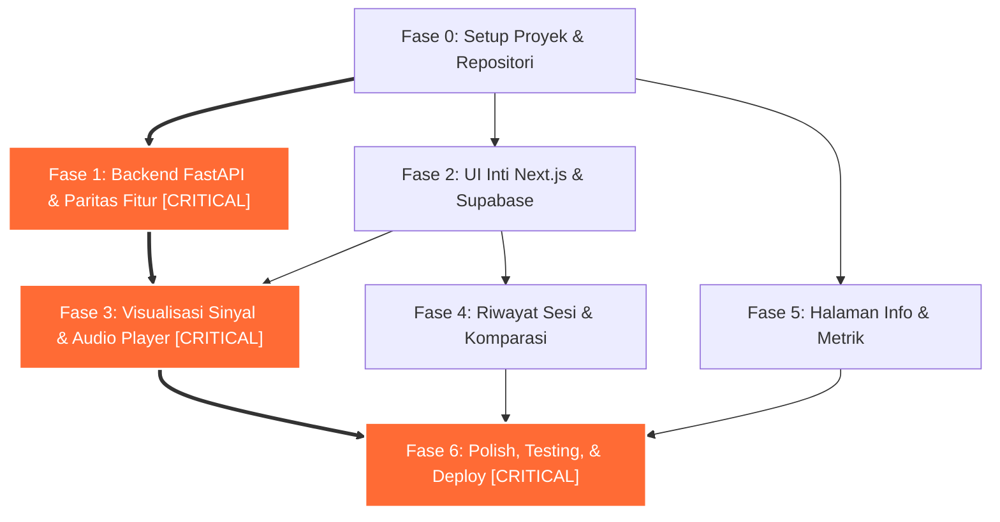

# Rencana Kerja & Rincian Tugas (Tasks Breakdown)
## Sound Lab: Step-by-Step Implementation Roadmap

> **Ringkasan Eksekutif:**  
> Dokumen ini menyajikan rincian tugas teknis bertahap yang siap dieksekusi untuk membangun platform *Sound Lab* dari awal hingga siap disebarkan (*deployment*). Terbagi menjadi 7 fase terstruktur dengan estimasi waktu, dependensi prasyarat, definisi selesai (*Definition of Done*), serta penandaan jalur kritis (*Critical Path*) untuk memandu tim pengembang atau perangkat AI koding.

---

## Daftar Isi
1. [Struktur Fase & Diagram Jalur Kritis](#1-struktur-fase--diagram-jalur-kritis)
2. [Fase 0: Persiapan Proyek & Fondasi Repositori](#2-fase-0-persiapan-proyek--fondasi-repositori)
3. [Fase 1: Backend FastAPI & Validasi Paritas Fitur (CRITICAL PATH)](#3-fase-1-backend-fastapi--validasi-paritas-fitur-critical-path)
4. [Fase 2: UI Inti Next.js & Integrasi Basis Data Supabase](#4-fase-2-ui-inti-nextjs--integrasi-basis-data-supabase)
5. [Fase 3: Visualisasi Akustik & Pemutar Gelombang Audio](#5-fase-3-visualisasi-akustik--pemutar-gelombang-audio)
6. [Fase 4: Riwayat Sesi & Komparasi Dua Audio](#6-fase-4-riwayat-sesi--komparasi-dua-audio)
7. [Fase 5: Halaman Dokumentasi Ilmiah & Etika AI](#7-fase-5-halaman-dokumentasi-ilmiah--etika-ai)
8. [Fase 6: Pengujian Mutu, Optimasi, Deployment, & README](#8-fase-6-pengujian-mutu-optimasi-deployment--readme)
9. [Tabel Rekapitulasi Jam Kerja & Estimasi Total](#9-tabel-rekapitulasi-jam-kerja--estimasi-total)

---

## 1. Struktur Fase & Diagram Jalur Kritis

Jalur kritis (**Critical Path**) ditandai dengan garis tebal ganda (`==>`). Keterlambatan pada tugas di jalur kritis akan langsung menunda tanggal penyelesaian keseluruhan proyek.

---

## 2. Fase 0: Persiapan Proyek & Fondasi Repositori

Tujuan: Menyiapkan lingkungan pengembangan, isolasi dependensi, dan fondasi struktur direktori.

- [ ] **Tugas 0.1: Inisialisasi Struktur Direktori Proyek**
  - **Deskripsi:** Membuat folder `backend/`, `frontend/`, `data/`, `samples/`, dan `docs/` sesuai arsitektur.
  - **Estimasi:** 1 jam
  - **Dependensi:** Tidak ada
  - **Definisi Selesai (DoD):** Struktur folder tercipta rapi, `.gitignore` dikonfigurasi untuk mengecualikan `.venv`, `node_modules`, `__pycache__`, dan berkas audio uji besar.

- [ ] **Tugas 0.2: Konfigurasi Dependensi Backend Python**
  - **Deskripsi:** Menyusun `backend/requirements.txt` dengan dependensi terkunci ketat: `fastapi`, `uvicorn`, `librosa==0.10.2`, `scikit-learn==1.8.0`, `soundfile`, `joblib`, `pandas`, `numpy`, `slowapi`.
  - **Estimasi:** 1.5 jam
  - **Dependensi:** Tugas 0.1
  - **Definisi Selesai (DoD):** Virtual environment aktif, seluruh paket terinstal tanpa konflik roda biner (*wheels*), dan verifikasi `python -c "import sklearn; assert sklearn.__version__ == '1.8.0'"` sukses.

- [ ] **Tugas 0.3: Inisialisasi Aplikasi Frontend Next.js**
  - **Deskripsi:** Membuat aplikasi Next.js (App Router, TypeScript, Tailwind CSS) di dalam direktori `frontend/`.
  - **Estimasi:** 1.5 jam
  - **Dependensi:** Tugas 0.1
  - **Definisi Selesai (DoD):** Perintah `npm run dev` berjalan lancar di `http://localhost:3000` dengan tema dasar gelap.

- [ ] **Tugas 0.4: Penyusunan Proyek Supabase & Migrasi Skema**
  - **Deskripsi:** Membuat proyek baru di Supabase Free Tier dan mengeksekusi skrip DDL SQL untuk tabel `analysis_history`.
  - **Estimasi:** 1 jam
  - **Dependensi:** Tidak ada
  - **Definisi Selesai (DoD):** Tabel `analysis_history` aktif di konsol Supabase, RLS diaktifkan, dan kunci API dicatat di `.env.local`.

---

## 3. Fase 1: Backend FastAPI & Validasi Paritas Fitur (CRITICAL PATH)

Tujuan: Membangun mesin inferensi audio deterministik dan memverifikasi keakuratan ekstraksi fitur terhadap hasil notebook pelatihan.

- [ ] **Tugas 1.1: Pembuatan Modul Pemuatan Model (Model Loader Singleton) [CRITICAL]**
  - **Deskripsi:** Mengimplementasikan fungsi pemuatan artefak `data/model_klasifikasi_audio.pkl` menggunakan `joblib.load()` di dalam siklus hidup `lifespan` FastAPI.
  - **Estimasi:** 2 jam
  - **Dependensi:** Tugas 0.2
  - **Definisi Selesai (DoD):** Model termuat sekali saat startup, membaca `model.classes_`, dan tersimpan di `app.state`.

- [ ] **Tugas 1.2: Implementasi Pipeline DSP Librosa Deterministik [CRITICAL]**
  - **Deskripsi:** Menulis fungsi `audio_pipeline.py` yang memuat audio (22050 Hz, mono), memotong hening via `librosa.effects.split(top_db=25)` + `np.concatenate`, melakukan chunking 3 detik (66.150 sampel), mengekstrak RMS, Centroid, ZCR, MFCC 1-13, dan menyusun tepat 10 fitur urutan wajib.
  - **Estimasi:** 4 jam
  - **Dependensi:** Tugas 1.1
  - **Definisi Selesai (DoD):** Fungsi menghasilkan DataFrame 1 baris x 10 kolom dengan nama kolom dan urutan yang tepat.

- [ ] **Tugas 1.3: Uji Paritas Fitur vs Ground Truth Notebook [CRITICAL]**
  - **Deskripsi:** Menjalankan `test_pipeline_parity.py` menggunakan 3 file sampel (`24-003 berisik (1).mp3`, `24-003 berisik (2).mp3`, dan `24-003 sunyi 2.mp3`).
  - **Estimasi:** 3 jam
  - **Dependensi:** Tugas 1.2
  - **Definisi Selesai (DoD):** Prediksi kelas cocok 100%, nilai RMS dan Centroid berada dalam batas toleransi $\pm 5-6\%$, dan tes pytest lolos hijau.

- [ ] **Tugas 1.4: Implementasi Endpoint RESTful FastAPI**
  - **Deskripsi:** Membangun rute `POST /api/predict`, `GET /api/model-info`, dan `GET /api/health` lengkap dengan eksekusi `asyncio.to_thread`, penanganan file temporer via `try ... finally (os.unlink)`, dan validasi berkas.
  - **Estimasi:** 3.5 jam
  - **Dependensi:** Tugas 1.2, Tugas 1.3
  - **Definisi Selesai (DoD):** Pengujian curl/Postman mengembalikan status 200 OK dengan skema JSON lengkap sesuai `api-spec.md`.

---

## 4. Fase 2: UI Inti Next.js & Integrasi Basis Data Supabase

Tujuan: Membangun fondasi antarmuka "Sound Lab", navigasi, komponen input, dan integrasi riwayat sesi.

- [ ] **Tugas 2.1: Implementasi Design System Token & Layout Shell**
  - **Deskripsi:** Mengonfigurasi `tailwind.config.ts` dengan palet warna Sound Lab (`#0B0F14`, `#121922`, `#FF6B35`, `#22D3C5`), memasang Google Font (Space Grotesk, Inter, JetBrains Mono), dan membangun sidebar responsif.
  - **Estimasi:** 3 jam
  - **Dependensi:** Tugas 0.3
  - **Definisi Selesai (DoD):** Seluruh halaman memiliki tata letak konsisten, navigasi desktop/mobile aktif, dan font terpasang sempurna.

- [ ] **Tugas 2.2: Komponen Unggah File Drag-and-Drop**
  - **Deskripsi:** Membuat komponen `FileDropzone.tsx` dengan efek drag-over pendaran cyan, validasi ekstensi klien, dan pembatasan ukuran $\le 15$ MB.
  - **Estimasi:** 2 jam
  - **Dependensi:** Tugas 2.1
  - **Definisi Selesai (DoD):** File yang diseret memicu status visual aktif; file non-audio atau $>15$ MB langsung memunculkan pesan error lokal.

- [ ] **Tugas 2.3: Modul Perekaman Mikrofon Langsung (Web Audio API)**
  - **Deskripsi:** Mengembangkan komponen `AudioRecorder.tsx` yang meminta izin mikrofon, merekam 5-30 detik dengan tombol berdenyut merah, dan menampilkan VU-meter live.
  - **Estimasi:** 3.5 jam
  - **Dependensi:** Tugas 2.1
  - **Definisi Selesai (DoD):** Pengguna dapat merekam suara langsung, melihat level meter aktif, dan audio otomatis dikonversi menjadi Blob WAV untuk dianalisis.

- [ ] **Tugas 2.4: Kartu Diagnosis Hasil Utama & Gauge Confidence**
  - **Deskripsi:** Membuat komponen `ResultCard.tsx` dengan badge pill berisik (oranye) / non-berisik (cyan), semi-circular gauge animasi hitung naik 800ms, dan probabilitas 2 kelas.
  - **Estimasi:** 3 jam
  - **Dependensi:** Tugas 2.1
  - **Definisi Selesai (DoD):** Hasil inferensi merender badge dan animasi angka dengan lancar.

- [ ] **Tugas 2.5: Integrasi Klien Supabase untuk Riwayat Sesi**
  - **Deskripsi:** Menghubungkan mutasi hasil analisis ke tabel `analysis_history` di Supabase dan mengelola state sesi menggunakan UUID lokal peramban.
  - **Estimasi:** 2 jam
  - **Dependensi:** Tugas 0.4, Tugas 2.4
  - **Definisi Selesai (DoD):** Setiap kali inferensi berhasil, record baru tersimpan di Supabase tanpa menghambat performa UI.

---

## 5. Fase 3: Visualisasi Akustik & Pemutar Gelombang Audio

Tujuan: Menghadirkan visualisasi ilmiah interaktif tingkat lanjut.

- [ ] **Tugas 3.1: Pemutar Audio dengan Waveform & Glowing Playhead [CRITICAL]**
  - **Deskripsi:** Membangun komponen canvas `WaveformPlayer.tsx` yang merender bentuk gelombang ter-downsample dan menggerakkan garis kursor vertikal cyan bercahaya saat audio diputar.
  - **Estimasi:** 4 jam
  - **Dependensi:** Tugas 2.4
  - **Definisi Selesai (DoD):** Audio dapat diputar, di-pause, di-seek dengan klik pada waveform, dan kursor bergerak sinkron pada 60 FPS.

- [ ] **Tugas 3.2: Render Spektrogram Inferno & Modal Zoom**
  - **Deskripsi:** Mengintegrasikan visualisasi spektrogram frekuensi hasil backend dan menyediakan modal perbesaran resolusi tinggi.
  - **Estimasi:** 2.5 jam
  - **Dependensi:** Tugas 2.4
  - **Definisi Selesai (DoD):** Spektrogram tampil tajam dengan colormap inferno dan dapat diklik untuk melihat detail sumbu frekuensi.

- [ ] **Tugas 3.3: Komponen Timeline Prediksi Per-Chunk (3 Detik)**
  - **Deskripsi:** Membuat baris segmen balok 3 detik dengan kode warna oranye/cyan dan label tegas *"Indikatif (Estimasi Segmen Lokal)"*.
  - **Estimasi:** 2.5 jam
  - **Dependensi:** Tugas 2.4
  - **Definisi Selesai (DoD):** Hover pada chunk menampilkan tooltip stempel waktu (misal: "Detik 03.0 - 06.0: Berisik 91%").

- [ ] **Tugas 3.4: Visualisasi Grafik Perbandingan 10 Fitur vs Rata-Rata Kelas**
  - **Deskripsi:** Membuat grafik batang horizontal membandingkan nilai 10 fitur audio uji terhadap referensi `class_means.json`.
  - **Estimasi:** 3 jam
  - **Dependensi:** Tugas 2.4
  - **Definisi Selesai (DoD):** Pengguna dapat melihat secara visual apakah RMS atau Centroid audio lebih dekat ke profil Berisik atau Sunyi.

- [ ] **Tugas 3.5: Panel Penjelasan Cerdas Bahasa Awam & Peringatan Ambang Rendah**
  - **Deskripsi:** Merender teks naratif penjelas hasil dan memicu banner peringatan kuning jika confidence $< 65\%$.
  - **Estimasi:** 1.5 jam
  - **Dependensi:** Tugas 2.4
  - **Definisi Selesai (DoD):** Audio dengan confidence 62% memunculkan kartu peringatan ambang rendah dengan rekomendasi uji ulang.

---

## 6. Fase 4: Riwayat Sesi & Komparasi Dua Audio

Tujuan: Memberikan kemampuan analisis perbandingan dan ekspor data pengujian.

- [ ] **Tugas 4.1: Halaman Riwayat Sesi & Ekspor CSV**
  - **Deskripsi:** Membangun halaman `/riwayat` yang membaca data dari Supabase berdasarkan `session_id`, dilengkapi filter kategori dan tombol unduh berkas CSV.
  - **Estimasi:** 3 jam
  - **Dependensi:** Tugas 2.5
  - **Definisi Selesai (DoD):** Tabel riwayat dapat disaring dan tombol ekspor mengunduh file `.csv` yang valid dibuka di Excel/Spreadsheet.

- [ ] **Tugas 4.2: Halaman Bandingkan (Side-by-Side Audio Comparison)**
  - **Deskripsi:** Mengembangkan halaman `/bandingkan` yang memungkinkan analisis komparatif dua file audio sekaligus dengan matriks selisih fitur.
  - **Estimasi:** 3.5 jam
  - **Dependensi:** Tugas 3.4
  - **Definisi Selesai (DoD):** Dua audio dapat diuji bersamaan dan menampilkan persentase delta energi RMS serta perbedaan kelas.

---

## 7. Fase 5: Halaman Dokumentasi Ilmiah & Etika AI

Tujuan: Menyajikan transparansi metodologi sains data kepada dosen dan penguji.

- [ ] **Tugas 5.1: Halaman "Tentang Model"**
  - **Deskripsi:** Membangun halaman `/tentang-model` yang menyajikan ringkasan Random Forest, tabel 10 fitur terpilih, metrik evaluasi (85% akurasi, F1 0.85, ROC-AUC 0.8688), dan matriks konfusi (17/3).
  - **Estimasi:** 2 jam
  - **Dependensi:** Tugas 2.1
  - **Definisi Selesai (DoD):** Seluruh data matematis dan tabel benchmarking 6 model tampil akurat sesuai laporan sains data.

- [ ] **Tugas 5.2: Halaman "Batasan & Etika"**
  - **Deskripsi:** Membangun halaman `/batasan-etika` yang memaparkan batasan domain dataset, potensi error pada suara musik/hujan, serta jaminan privasi *Zero Raw-Audio Retention*.
  - **Estimasi:** 1.5 jam
  - **Dependensi:** Tugas 2.1
  - **Definisi Selesai (DoD):** Pernyataan privasi dan etika AI tersusun rapi dengan tipografi nyaman dibaca.

---

## 8. Fase 6: Pengujian Mutu, Optimasi, Deployment, & README

Tujuan: Memastikan kestabilan produksi, audit performa, dan publikasi online.

- [ ] **Tugas 6.1: Penanganan Status Cold-Start Backend di Frontend**
  - **Deskripsi:** Membuat pemanggilan awal `GET /api/health` saat aplikasi dimuat; jika server Render sedang *spinning up*, tampilkan banner informatif beranimasi.
  - **Estimasi:** 1.5 jam
  - **Dependensi:** Tugas 1.4, Tugas 2.1
  - **Definisi Selesai (DoD):** Pengguna tidak merasa aplikasi rusak saat backend gratis membutuhkan waktu bangun ~30-45 detik.

- [ ] **Tugas 6.2: Audit Aksesibilitas & Uji Kompatibilitas Peramban**
  - **Deskripsi:** Menjalankan Google Lighthouse, memvalidasi rasio kontras WCAG AA, dan menguji navigasi keyboard.
  - **Estimasi:** 2 jam
  - **Dependensi:** Seluruh tugas UI
  - **Definisi Selesai (DoD):** Skor Lighthouse Accessibility $\ge 95$, Performance $\ge 90$.

- [ ] **Tugas 6.3: Penyebaran Layanan Produksi (Deployment)**
  - **Deskripsi:** Menerapkan frontend ke Vercel dan backend ke Render/Hugging Face Spaces (dengan Dockerfile berisi `ffmpeg`), serta mengonfigurasi variabel lingkungan produksi.
  - **Estimasi:** 3 jam
  - **Dependensi:** Seluruh fase sebelumnya
  - **Definisi Selesai (DoD):** Aplikasi online dapat diakses publik melalui URL HTTPS dan berhasil menganalisis audio langsung di server cloud.

- [ ] **Tugas 6.4: Penulisan Dokumentasi Panduan Menjalankan (README.md)**
  - **Deskripsi:** Menyusun panduan instalasi lokal lengkap (langkah instalasi Python, ffmpeg, npm, konfigurasi .env) dan dokumentasi arsitektur.
  - **Estimasi:** 2 jam
  - **Dependensi:** Tugas 6.3
  - **Definisi Selesai (DoD):** Pengembang lain dapat mereproduksi dan menjalankan aplikasi di komputer lokal dalam $\le 15$ menit mengikuti README.

---

## 9. Tabel Rekapitulasi Jam Kerja & Estimasi Total

| Fase Proyek | Jumlah Tugas | Estimasi Waktu (Jam) | Keterangan Status |
| :--- | :---: | :---: | :--- |
| **Fase 0: Persiapan Proyek & Fondasi** | 4 Tugas | 5.0 Jam | Fondasi Awal |
| **Fase 1: Backend FastAPI & Paritas Fitur** | 4 Tugas | 12.5 Jam | **Jalur Kritis Utama** |
| **Fase 2: UI Inti Next.js & Supabase** | 5 Tugas | 14.0 Jam | Integrasi Inti |
| **Fase 3: Visualisasi Akustik & Player** | 5 Tugas | 13.5 Jam | **Jalur Kritis UI** |
| **Fase 4: Riwayat Sesi & Komparasi** | 2 Tugas | 6.5 Jam | Fitur Analitik |
| **Fase 5: Halaman Dokumentasi Ilmiah** | 2 Tugas | 3.5 Jam | Transparansi Akademik |
| **Fase 6: Polish, Testing, & Deploy** | 4 Tugas | 8.5 Jam | **Jalur Kritis Rilis** |
| **TOTAL KESELURUHAN** | **26 Tugas** | **63.5 Jam** | **Estimasi ~8 Hari Kerja Normal** |
